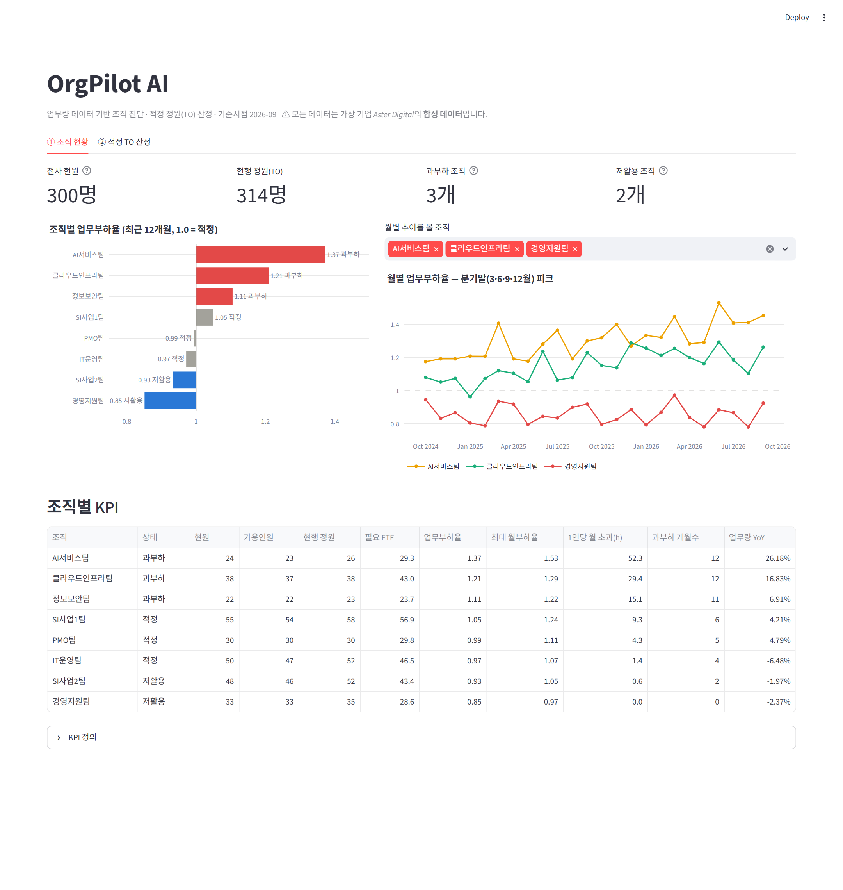
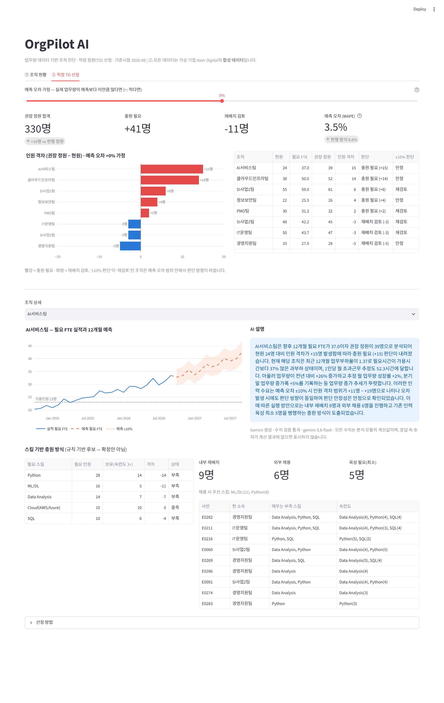
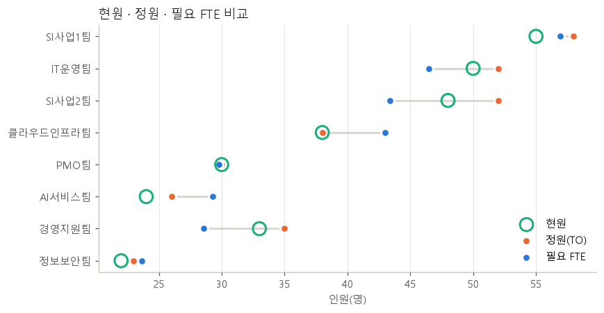
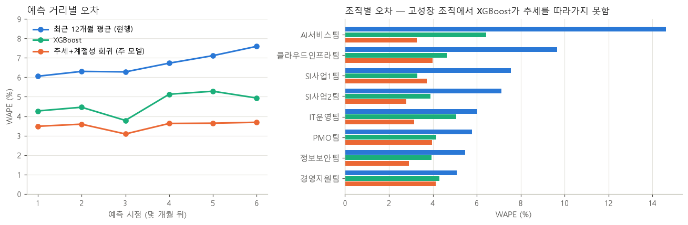
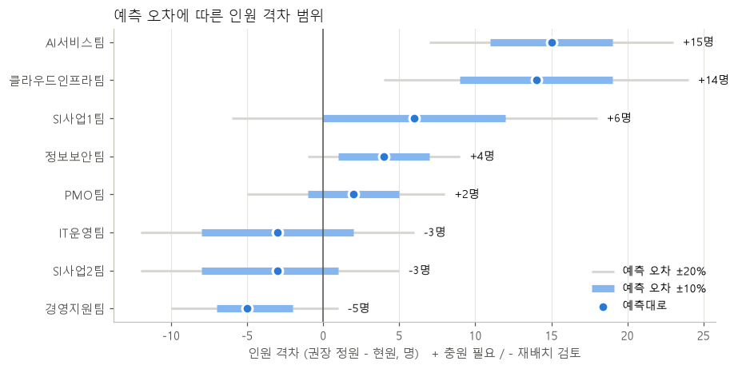
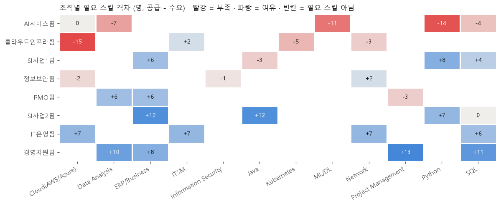

# OrgPilot AI

**업무량 데이터 기반 조직 진단 → 적정 정원(TO) 산정 → 스킬 기반 충원 방식 제안**을 하는 HR Analytics 프로젝트입니다.
Claude Code로 개발했고, 무엇을 시켰고 어떻게 검증·수정했는지를 [개발 기록](docs/claude_code_log.md)에 남겼습니다.

> ⚠ **모든 데이터는 합성(synthetic) 데이터입니다.** 가상 기업 *Aster Digital*(8개 조직, 300명)을 가정해 직접 생성했으며, 실존 기업·인물·실제 인사 데이터와 무관합니다. 결과 수치는 방법론을 보여 주기 위한 것이며 실제 조직의 성과가 아닙니다.



---

## 1. 문제 정의

많은 조직의 인력계획은 **"작년 정원 + 부서 요청분"** 에 의존합니다. 이 방식은 업무량 변화를 반영하지 못해서,

- 업무가 빠르게 늘어나는 조직(AI·클라우드)은 만성 과부하에 빠지고
- 업무가 줄어드는 조직은 정원이 남으며
- 새로 필요한 역량(ML/DL, Cloud)은 채용·육성 계획 없이 부족한 채로 남습니다.

이 프로젝트는 업무량 데이터로 다음 세 질문에 답합니다.

| 질문 | 모듈 |
|---|---|
| 지금 어느 조직이 과부하/저활용인가? | A. 조직 생산성 진단 |
| 향후 12개월, 조직별 적정 인원은 몇 명인가? 예측이 틀리면? | B. 업무량 예측 + 적정 TO 산정 |
| 부족 인원을 재배치·채용·육성 중 어떻게 채울 것인가? | C. 스킬 기반 매칭 |

**직무와의 연결** (현대오토에버 HRM 직무 기술 기준)

| 직무 내용 | 이 프로젝트에서 한 것 |
|---|---|
| 조직·인력 생산성 지표 분석 기반 적정 정원(TO) 산정 | Module A·B: 업무부하율 KPI → 업무량 예측 → FTE 환산 → 권장 정원 |
| 조직진단·인력계획 수립 | 현행 정원 방식의 한계를 데이터로 보여 주고, 판단 안정성까지 포함한 정원 제안 |
| HR 데이터 수집·통합·정제, 분석·인사이트 도출 | 5개 테이블 데이터 설계, 무결성 검증 자동화, 분석 노트북 |
| 구성원 역량·스킬 중심 HR 운영 체계 | Module C: 스킬 공급·수요 격차, 재배치/채용/육성 3분할 |
| 생성형 AI 기반 개발 도구 활용 HR 솔루션 개발 | Claude Code로 전 과정 개발, Gemini 기반 설명 기능 + 수치 검증 |
| 분석 결과를 대시보드로 구현·전달 | Streamlit 대시보드 2개 화면 |

## 2. 핵심 결과 (합성 데이터 기준, 기준시점 2026-09)

| 조직 | 업무부하율 | 현원 | 현행 정원 | 권장 정원 | 판단 | 예측 ±10% 시 |
|---|---|---|---|---|---|---|
| AI서비스팀 | **1.37** | 24 | 26 | 39 | 충원 +15 | 안정 (+11~+19) |
| 클라우드인프라팀 | **1.21** | 38 | 38 | 52 | 충원 +14 | 안정 (+9~+19) |
| SI사업1팀 | 1.05 | 55 | 58 | 61 | 충원 +6 | 재검토 (0~+12) |
| 정보보안팀 | 1.11 | 22 | 23 | 26 | 충원 +4 | 안정 (+1~+7) |
| PMO팀 | 0.99 | 30 | 30 | 32 | 충원 +2 | 재검토 |
| IT운영팀 | 0.97 | 50 | 52 | 47 | 재배치 검토 −3 | 재검토 |
| SI사업2팀 | 0.93 | 48 | 52 | 45 | 재배치 검토 −3 | 재검토 |
| 경영지원팀 | **0.85** | 33 | 35 | 28 | 재배치 검토 −5 | 안정 (−7~−2) |

- **현행 방식의 문제를 수치로 확인**: 현행 정원은 성장 조직(AI·클라우드)에서 필요 인원보다 13~14명 적고, 축소 조직(SI2·경영지원)에서는 7명 많습니다.
- **예측 정확도**: 추세+계절성 회귀의 월 업무량 오차(WAPE)는 **3.5%** 로, 현행 관행에 해당하는 "최근 12개월 평균"(6.6%)의 절반 수준입니다.
- **판단의 확실성 구분**: AI·클라우드는 예측이 20% 과대였어도 충원이 필요한 **확실한 충원 대상**입니다. 반면 SI1·SI2·IT운영·PMO는 ±10% 오차 안에서 판단이 바뀌므로 **분기별 재검토 대상**입니다.
- **충원 방식**: 충원 필요 41명 = 내부 재배치 11명 + 외부 채용 30명. AI서비스팀은 ML/DL 부족(11명)이 채용 인원(6명)보다 커서 **기존 인력 육성 최소 5명**이 함께 필요합니다.



<details>
<summary>분석 노트북 차트 미리보기</summary>

| | |
|---|---|
|  |  |
|  |  |

</details>

## 3. 데이터

5개 테이블, 24개월(2024-10 ~ 2026-09), seed 고정으로 **재현 가능**합니다. → [생성 문서](docs/data_generation.md)

| 테이블 | 내용 | 행 수 |
|---|---|---|
| `departments` | 조직, 기능, 현원 | 8 |
| `employees` | 직무군, 근속, 재직/휴직 | 300 |
| `workload` | 월별 업무건수, 건당 표준처리시간 | 192 |
| `skills` | 직원별 스킬 3~5개, 숙련도 1~5 | 1,199 |
| `staffing_plan` | 월별 정원(TO)·현원 | 192 |

- 조직별로 업무량 추세, 분기말 계절성, 스킬 분포를 다르게 설계했습니다.
- 생성기가 알고 있는 '진짜 필요 인원'은 **테이블에 저장하지 않습니다**. 분석은 업무건수에서 출발해야 하고, 저장 컬럼을 스키마로 고정해 누출을 검증합니다.
- 무결성 검증 7종(PK/FK, 결측, 현원 일치, 기간·미래 정보 누출, 값 범위)을 자동화했습니다. **검증 함수가 실제로 오류를 잡는지** 일부러 망가뜨린 데이터로 테스트합니다.

## 4. 방법론

자세한 내용은 [docs/methodology.md](docs/methodology.md)를 참고하세요.

**Module A. 조직 생산성 진단**
```
업무부하율 = Σ(업무건수 × 표준시간) / Σ(가용인원 × 140h)      최근 12개월, 휴직자 제외
```

**Module B. 업무량 예측 + 적정 TO**
```
예측       log(업무건수) = a + b·t + c·분기말 + d·1월           조직별 회귀
필요 FTE   = 예측 업무건수 × 표준시간 / 140h                  향후 12개월 평균
권장 정원  = ceil(필요 FTE / 가용비율)                        휴직자 포함 머릿수로 환산
민감도     실제 = 예측 × (1 ± 10%, 20%) → 판단 방향이 바뀌는지 확인
```
- **검증**: Rolling-origin 방식으로 학습 12개월부터 기준점을 한 달씩 옮기며 1~6개월 앞을 예측했습니다(기준점 12개).
- **모델 선택**: 3개 모델을 비교했습니다. XGBoost는 추세를 학습 범위 밖으로 외삽하지 못해, 고성장 조직에서 오차가 2배였습니다(6.4% vs 3.3%). 그래서 해석 가능한 회귀를 선택했습니다.
- **합성 데이터라서 가능한 추가 검증**: 생성기의 숨은 정답과 비교해 8개 조직 모두 예측 필요 FTE가 5% 이내였습니다.

**Module C. 스킬 기반 매칭 (규칙 기반)**
- 공급은 숙련도 3 이상인 가용 인원, 수요는 직무별 필요 비율 × 권장 정원입니다.
- 재배치 후보는 6개 규칙으로 정합니다. 핵심 규칙은 **그 사람이 빠져서 원 조직에 새 스킬 부족이 생기면 제외**하는 것입니다.

**AI 설명 (Gemini)**
- 숫자는 Python이 계산하고, LLM은 설명만 합니다.
- **응답 속 모든 숫자를 계산 결과와 대조**합니다. 하나라도 계산 결과에 없으면 그 응답을 버리고 계산 기반 템플릿으로 대체합니다.
- 8개 조직의 응답이 모두 검증을 통과했습니다. 대시보드는 검증된 저장 응답만 보여 주며, API를 호출하지 않습니다.

## 5. Claude Code 활용 기록

전체 기록: **[docs/claude_code_log.md](docs/claude_code_log.md)** (Phase별로 요청 → 생성물 → 설계 판단 → 검증 방법 → 발견·수정한 문제)

Claude Code가 만든 코드를 그대로 쓰지 않고, **결과를 다른 방법으로 다시 계산하거나 화면·출력을 직접 대조해 오류를 찾았습니다.** 주요 사례는 다음과 같습니다.

| 단계 | 발견한 문제 | 어떻게 찾았나 | 조치 |
|---|---|---|---|
| AI 설명 | Gemini 3의 내부 추론이 출력 토큰을 소모해 **응답이 문장 중간에 끊겼는데, 숫자는 맞아서 수치 검증을 통과하고 캐시에 저장됨** | 실제 응답 전문을 직접 읽음 | 응답 완료 여부(finish_reason) 검사 추가, 잘린 캐시 삭제·재생성, 회귀 테스트 |
| 정원 산정 | `0.1×3×40 = 12.000000000000002` → 올림하면 **정원 1명 과다** | 손계산 테스트 작성 중 | 소수 6자리 반올림 후 올림, 회귀 테스트 |
| 대시보드 | 예측 오차 슬라이더를 움직이면 차트는 바뀌는데 **상단 카드는 그대로**(+41 vs +65) | 노트북 민감도 표와 화면 숫자 대조 | 카드도 같은 가정으로 계산, 자동 테스트(AppTest) 추가 |
| 스킬 매칭 | 재배치 규칙이 부족 스킬 **종류가 많은 조직(AI)에 유리**하게 작동 → 클라우드 재배치 1명뿐 | 결과의 원인 추적 | 결과를 원하는 대로 맞추려 규칙을 바꾸지 않고 **한계로 명시**, "확정안이 아닌 검토 후보"로 표기 |
| 스킬 매칭 | 테스트가 공식을 테스트 안에서 다시 계산 → **모듈이 틀려도 통과하는 무의미한 테스트** | 테스트 코드 검토 | 모듈 실제 출력을 대조하는 테스트로 교체 |
| KPI | Phase 1 점검(1.22)과 KPI 모듈(1.37)의 AI팀 부하율이 다름 | 단계 간 수치 비교 | 계산 기준 차이(월별 당시 현원·휴직 제외)임을 확인하고 문서화 |
| 노트북 | 모든 표 출력이 **두 번씩 저장** | 셀별 출력 종류를 출력해 확인 | 실행 방식 수정 |
| 차트 | 같은 값의 점이 겹쳐 가려짐, 범례 기호 구분 불가, 라벨 겹침 | 차트 이미지를 직접 열어 확인 | 마커·범례·라벨 위치 수정 |

**검증 원칙**
- **손계산 가능한 최소 예제로 공식 검증**: 예를 들어 10명 × 140h = 100건 × 14h이면 부하율은 정확히 1.0이어야 합니다.
- **검증 함수 자체를 검증**: 일부러 망가뜨린 데이터로 검증 함수가 실제로 실패하는지 확인했습니다.
- **미래 정보 누출 검사**: 가짜 모델(spy)을 넣어, 모델 함수 안에서 학습 데이터가 항상 과거인지 직접 확인했습니다.
- **LLM 출력은 매번 기계적으로 대조**: 테스트에서만이 아니라 런타임에서도 모든 응답을 검사합니다.
- 테스트 **63개**로, 모두 API를 호출하지 않습니다.

## 6. 한계

- **합성 데이터**: 생성 구조(추세 + 계절성 + 노이즈)를 알고 설계했으므로, 여기서 예측이 잘 맞는다고 해서 실제 조직에서도 잘 맞는다는 근거는 되지 않습니다. 실제 적용 시에는 업무량 측정 체계(티켓·공수 데이터)의 품질 검증이 먼저 필요합니다.
- **고정 가정값**: 1인당 가용시간 140h, 건당 표준시간, 조직별 필요 스킬 비율은 모두 가정값입니다. 실제로는 근무제도·직무분석·현업 인터뷰로 정해야 합니다.
- **12개월 예측은 직접 검증하지 못함**: 데이터가 24개월이라 검증 가능한 예측 거리는 6개월까지입니다. 그래서 ±10% 민감도로 보완했습니다.
- **구조 변화 미반영**: 신규 사업 수주, 조직 개편, 자동화에 따른 생산성 변화는 반영하지 않았습니다.
- **스킬 매칭의 범위**: 스킬만 봅니다. 본인 희망, 경력 경로, 성과, 업무 인계는 반영하지 않으므로, 결과는 **검토 후보 목록**입니다.
- **AI 설명 검증의 범위**: 숫자가 사실 목록에 있는지만 봅니다. 맞는 숫자를 엉뚱한 항목에 붙이는 오류는 잡지 못합니다.
- **개인정보**: Gemini 무료 등급은 입력이 서비스 개선에 쓰일 수 있습니다. **실제 인사 데이터를 무료 등급 API에 보내면 안 됩니다.**

## 7. 실행 방법

```bash
python -m venv .venv
.venv/Scripts/activate            # macOS/Linux: source .venv/bin/activate
pip install -r requirements.txt

python -m src.data_gen            # 합성 데이터 생성 (seed 42, 결과 동일)
python -m src.validate            # 무결성 검증
pytest                            # 테스트 63개 (API 호출 없음)
streamlit run app/dashboard.py    # 대시보드 → http://localhost:8501
```

AI 설명을 새로 생성하려면 `.env.example`을 `.env`로 복사해 Gemini API 키를 넣고 `python -m src.ai_explain`을 실행합니다. 이미 생성·검증된 응답이 저장소에 포함되어 있어서, 키가 없어도 대시보드에서 볼 수 있습니다.

## 8. 구조

```
├── README.md
├── app/dashboard.py            Streamlit 대시보드 (2개 화면)
├── src/
│   ├── config.py               공통 가정값 (기준시점, 1인당 가용시간)
│   ├── data_gen.py             합성 데이터 생성
│   ├── validate.py             데이터 무결성 검증
│   ├── kpi.py                  Module A
│   ├── forecast.py             Module B — 예측·검증
│   ├── staffing.py             Module B — FTE·정원·민감도
│   ├── skill_match.py          Module C
│   ├── pipeline.py             전체 분석 실행 진입점
│   └── ai_explain.py           Gemini 설명 + 수치 검증
├── tests/                      63개 테스트
├── notebooks/analysis.ipynb    분석 노트북 (Module A·B·C)
├── scripts/capture_screenshots.py   README 화면 캡처
├── data/synthetic/             CSV · SQLite · AI 설명 캐시
└── docs/
    ├── data_generation.md
    ├── methodology.md
    ├── claude_code_log.md      Claude Code 활용 기록
    └── images/
```

**기술 스택**: Python 3.12 · pandas · NumPy(회귀: 최소제곱) · XGBoost(비교 모델) · SQLite · Streamlit · Plotly · matplotlib · Gemini API · pytest
